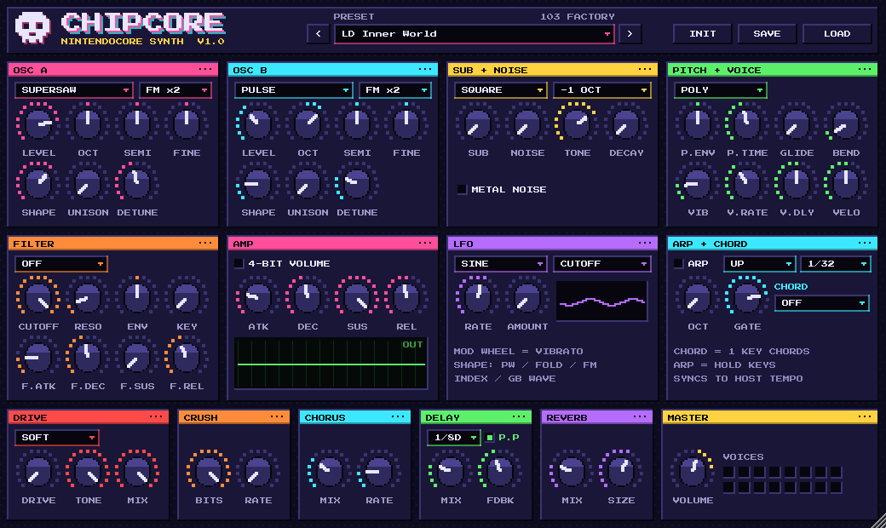

# CHIPCORE - nintendocore synth

VST3-синтезатор для nintendocore / chipcore / crabcore: 8-битные волны NES и Game Boy плюс современные суперсо, FM, дисторшн и эффекты. 103 заводских пресета, пиксельный интерфейс.



## Установка (Windows)

1. Скачай `CHIPCORE-Setup.exe` со страницы **Releases** (сборка `latest`) и запусти. Он спросит только папку (по умолчанию `C:\Program Files\Common Files\VST3`) и положит туда `CHIPCORE.vst3`. Удалить - просто удалить эту папку.
   Если Windows покажет «Система Windows защитила ваш компьютер» - нажми «Подробнее» → «Выполнить в любом случае» (установщик не подписан платным сертификатом).
2. Вручную (без установщика): распакуй `CHIPCORE-Windows-x64.zip` и скопируй папку `CHIPCORE.vst3` в `C:\Program Files\Common Files\VST3`.
3. **FL Studio:** Options → Manage plugins → Find installed plugins, потом в браузере плагинов включи звёздочку у CHIPCORE (Generators).
   **Studio One / Ableton / Reaper:** просто пересканируй плагины, CHIPCORE появится среди инструментов.
4. `CHIPCORE.exe` - отдельная версия без DAW (можно играть с MIDI-клавиатуры).

Ничего дополнительно ставить не нужно (Visual C++ runtime вшит).

## Что внутри

| Блок | Что делает |
|---|---|
| **OSC A / OSC B** | Волны: PULSE (NES, ширина 5-50%), TRI NES (4-битный ступенчатый треугольник), SAW, SUPERSAW (7 голосов), SINE (с wavefold), FM (2-оп, ratio x0.5…x7), GB WAVE (8 таблиц Game Boy), NOISE (LFSR NES). Октава, полутоны, расстройка, юнисон до 7 голосов |
| **SHAPE** | Зависит от волны: ширина импульса / сглаживание треугольника / биткраш пилы / разброс суперсо / складывание синуса / индекс FM / выбор GB-таблицы / металлический шум |
| **SUB + NOISE** | Саб-осциллятор (-1/-2 октавы) и отдельный NES-шум со своим затуханием - для атак, малых, хэтов |
| **PITCH + VOICE** | Питч-огибающая (бочки, лазеры, «блипы»), глайд, POLY / MONO / LEGATO, вибрато с задержкой, диапазон бенда |
| **FILTER** | LP12 / LP24 / HP / BP с резонансом, своей ADSR и кейтреком |
| **AMP** | ADSR + режим **4-BIT VOLUME** (громкость шагами как на NES) |
| **LFO** | На питч, SHAPE (ШИМ), срез, громкость (гейт) или панораму |
| **ARP + CHORD** | Арпеджиатор до 1/64 (классический «аккорд через арп» как в NES-музыке), синк к темпу DAW. **CHORD** - одна клавиша играет целый аккорд (работает и без арпа) |
| **FX** | Drive (soft/hard/fold/fuzz) → Bitcrusher → Chorus → Delay (синк, пинг-понг) → Reverb |

**Управление:** двойной клик по ручке - сброс, наведение - значение. Колесо модуляции = вибрато. Окно тянется за правый нижний угол.

## Пресеты (103)

- **LEAD (22):** Hero Pulse 25/12, Square Knight, Breakdown Screamer, Mosh Pit Saw, Inner World, Dinner Bell, Shotgun Blip, Grammar Lesson, Snow Eater, Escimo Ice, 4-Bit Volume, Glide Hero, Pitch Bomb, Fuzz Chip Guitar, Supersaw Anthem, FM Scream, Wavefold Rage, Arcade Whistle, Boss Fight, Pulse Wobble, Crushed Hero
- **BASS (16):** NES Triangle, Triangle Thump, Pulse Chug, Djent Pulse, Saw Growl, GB Wave Bass, Reese Cart, FM Punch, Octave Pump, Sub Rumble, Wobble 8-Bit, Breakdown Drop, Slap Chip, Fuzz Chug Gtr, Rolling 16ths, Acid Cart
- **ARP (14):** Major Sparkle, Minor Rush, Power Stutter, Dinner Is Ready, Classic NES 1-64, Minor NES 1-64, Sus Climber, Random Coins, Trance Gate, Dim Panic, 5th Stack Fanfare, Echo Cascade, Played Order FM, Min7 Bubbles
- **CHORD (10):** Mosh Stab Minor, Major Stab, Min7 Chip Stab, Power Gate, Euphoric Saws, Octave Hits, Chip Brass, Detuned Organ, Crushed Chord, Trancecore Pluck
- **PLUCK (10):** Pulse Pluck, Triangle Mallet, GB Bell, FM Marimba, Weekly Keys, Harp Sparkle, Crystal Snow, Saw Pluck, Koto Chip, Music Box
- **PAD (8):** Overworld Dawn, Pulse Choir, Frozen Cartridge, Inner World Haze, Save Point, Dark Dungeon, 4-Bit Strings, Snowfield
- **DRUM (13):** NES/Pulse/Breakdown/Zap Kick, NES/Crack/Metal Snare, Closed/Open/Metal Hat, Crash 8-Bit, Tom Drop, Clap Chip
- **FX (10):** Coin Get, Power Up, Laser Shot, Jump, Explosion, 1-Up Chime, Game Over Dive, Warp Riser, Glitch Stutter, Alarm Siren

Все пресеты выровнены по громкости. Свои пресеты сохраняются кнопкой **SAVE** в `Документы\CHIPCORE Presets` (*.chipcore), открываются кнопкой **LOAD**.

## Советы под nintendocore

- Основной лид: **LD Hero Pulse 25** или **LD Breakdown Screamer** поверх гитар, дублируй октавой выше с **LD Hero Pulse 12**.
- Брейкдауны: **BS Fuzz Chug Gtr** / **BS Pulse Chug** в унисон с бочкой, **CH Power Gate** для «рубки».
- Быстрые аккорды «как на приставке»: **AR Classic NES 1-64** - держи одну ноту, арп сам сыграет мажор.
- Трансовые/эмо-куски: **LD Inner World**, **CH Euphoric Saws**, **PD Overworld Dawn**.
- Чиповые барабаны: пресеты **DR**, играй их отдельными каналами (C3-C5).

## Сборка из исходников

Сборка под Windows идёт автоматически через GitHub Actions (`.github/workflows/build.yml`) при каждом пуше в `main`. Локально:

```
cmake -S . -B build -A x64
cmake --build build --config Release
```

JUCE 8 скачивается сам. Пресеты описаны в `tools/gen_presets.py` (после правок: `python tools/calibrate.py` - пересоберёт и выровняет громкость).

Шрифт Press Start 2P - SIL Open Font License (`Resources/OFL.txt`). Названия пресетов - отсылки к сцене, звуки оригинальные.
